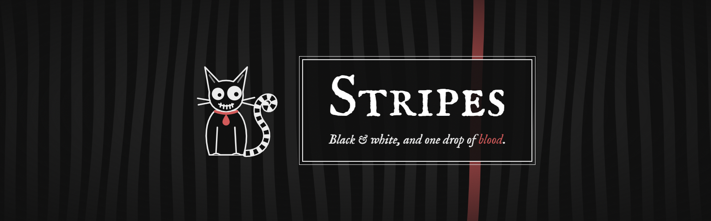
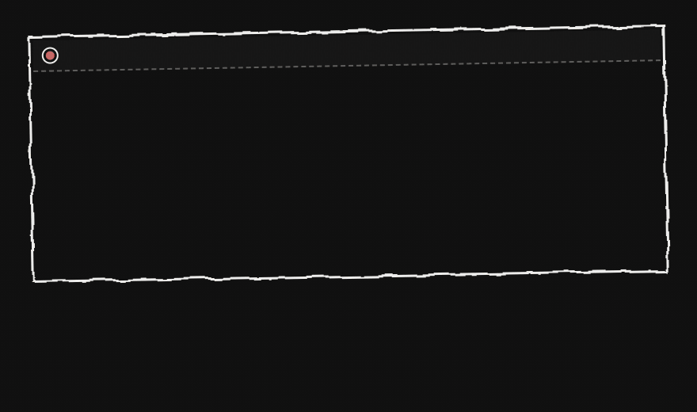
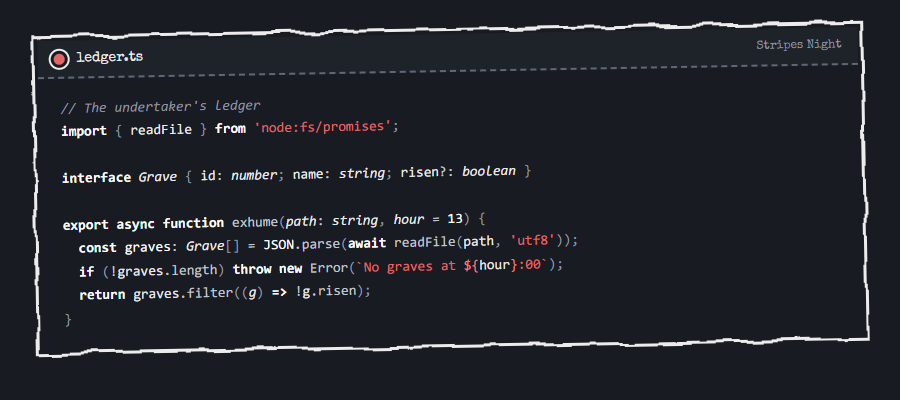
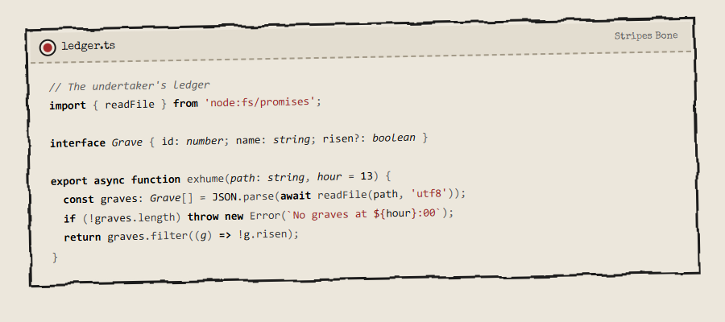
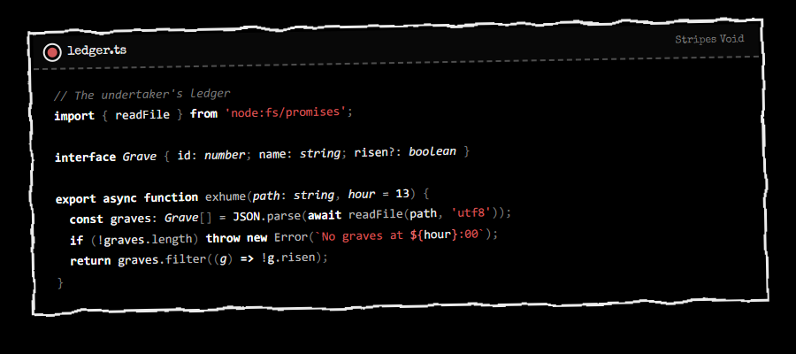
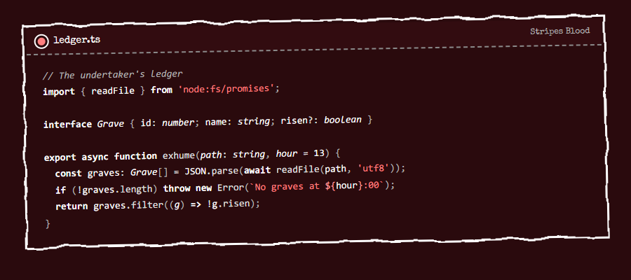
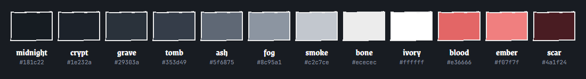
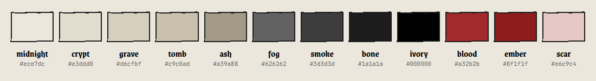
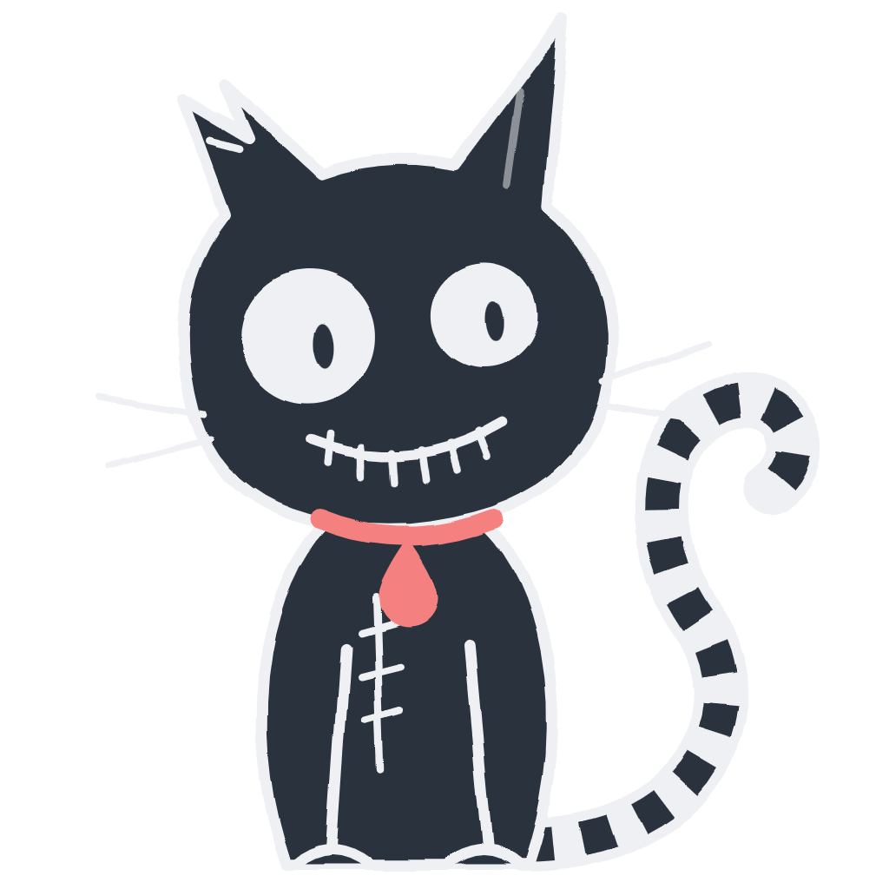

<p align="center">
  
</p>

<p align="center">
  <a href="README.md">English</a> · <b>Español</b>
</p>

<p align="center">
  <a href="https://github.com/laktolyx-rgb/Stripes/actions/workflows/ci.yml"></a>
  <a href="https://marketplace.visualstudio.com/items?itemName=stripes-theme.stripes"></a>
  <a href="https://open-vsx.org/extension/stripes-theme/stripes"></a>
  <a href="https://www.npmjs.com/package/@stripes-theme/palette"></a>
  
  <a href="LICENSE"></a>
</p>

<p align="center"><i>Un tema gótico entintado a mano, como un stop-motion. Diez apps, cuatro variantes, una paleta.<br>Todo es blanco y negro, menos lo único que importa.</i></p>

<p align="center">
  <a href="https://laktolyx-rgb.github.io/Stripes"><b>Sitio y playground</b></a> ·
  <a href="#instalación">Instalación</a> ·
  <a href="#la-paleta">Paleta</a> ·
  <a href="CONTRIBUTING.md#español">Agrega una app</a>
</p>

<p align="center"></p>

## La película, en cuatro actos

| | |
|:---:|:---:|
| **Acto I: Night**<br><sub>El original. Carbón, hueso y sangre.</sub><br> | **Acto II: Bone**<br><sub>Pergamino viejo y tinta seca. La variante clara.</sub><br> |
| **Acto III: Void**<br><sub>Negro `#000` real para OLED. Los píxeles duermen en sus ataúdes.</sub><br> | **Acto IV: Blood**<br><sub>Alto contraste. Cada token pasa WCAG AAA.</sub><br> |

## Por qué Stripes

- **Un solo acento, usado a propósito.** La estructura sale del brillo y la tipografía: keywords en negrita, comentarios en cursiva, constantes en blanco. El rojo se guarda para strings, links y errores, así que cuando aparece significa algo.
- **Legible por ley.** El CI revisa cada color de texto contra WCAG en cada commit: AA en Night, Bone y Void, y AAA en Blood. Un cambio de paleta que empeore la legibilidad no entra.
- **Una paleta para todas las apps.** [`palette.json`](palette/palette.json) es la única fuente de colores. Los ports se generan, nunca se ajustan a mano, así que VS Code y tu terminal no se desincronizan.
- **Una marca, no una lista de hex.** Wallpapers, una mascota (hola, Mortimer), un [playground](https://laktolyx-rgb.github.io/Stripes#playground) y una [especificación](palette/spec.md) que dice qué va en cada lugar.

## Instalación

| App | Cómo |
|---|---|
| **VS Code** · Cursor · VSCodium | Marketplace / Open VSX: busca **Stripes**, luego `Ctrl+K Ctrl+T` → *Stripes Night*. ([detalles](ports/vscode)) |
| **Neovim** | lazy.nvim: `{ "laktolyx-rgb/Stripes", config = … }`, con Treesitter, LSP y 15 plugins. ([detalles](ports/nvim)) |
| **Zed** | Extensions → **Stripes** ([detalles](ports/zed)) |
| IDEs de **JetBrains** | Plugins → Marketplace → **Stripes** ([detalles](ports/jetbrains)) |
| **Ghostty** | `theme = dark:stripes-night,light:stripes-bone` ([detalles](ports/ghostty)) |
| **Kitty** | `include stripes-night.conf` ([detalles](ports/kitty)) |
| **Alacritty** | `import = ["stripes-night.toml"]` ([detalles](ports/alacritty)) |
| **Windows Terminal** | Copia `stripes.json` a la carpeta Fragments ([detalles](ports/windows-terminal)) |
| **Obsidian** | Temas de la comunidad → **Stripes**, con Style Settings para Void y Blood ([detalles](ports/obsidian)) |
| **Discord** | CSS para Vencord / BetterDiscord ([detalles](ports/discord)) |

Cada release incluye zips para terminales y apps, y **16 wallpapers** (4 variantes × 1080p, 1440p, 4K y móvil) en la [página de Releases](https://github.com/laktolyx-rgb/Stripes/releases).

> ¿No está tu app? Un port nuevo es un solo archivo. Mira [**Agrega una app**](CONTRIBUTING.md#español).

## La paleta




La tabla completa de hex de las 4 variantes está en el [README en inglés](README.md#the-palette) y en [`palette/palette.json`](palette/palette.json).

### Úsala en tu proyecto

```sh
npm i @stripes-theme/palette
```

```js
import { variants } from '@stripes-theme/palette';
variants.night.roles.keyword; // { color: 'ivory', hex: '#ffffff', bold: true, italic: false }
```

```css
@import '@stripes-theme/palette/css';            /* variables CSS, cambia con <html data-stripes="bone"> */
@import '@stripes-theme/palette/tailwind.css';   /* Tailwind v4: bg-stripes-midnight text-stripes-blood */
```

## Cómo está hecho

```
palette/palette.json ──► builder (valida WCAG) ──► templates/<app> ──► ports/<app>
                                                                   └─► sitio, wallpapers, GIF
```

```sh
npm install
npm run validate     # tabla de contraste por variante
npm run build        # paquete de paleta + todos los ports
npm run check        # CI: falla si ports/ no coincide con las plantillas
npm test
npm run site:dev     # la landing
npm run assets       # íconos, vistas previas, imagen social, wallpapers, GIF
```

## Créditos

Hecho por [@laktolyx-rgb](https://github.com/laktolyx-rgb) y la comunidad. Mortimer se interpreta a sí mismo.
Inspirado en el oficio del stop-motion hecho a mano y en las comunidades de temas open source que vinieron antes ([Catppuccin](https://github.com/catppuccin), [Dracula](https://github.com/dracula)).

MIT © Stripes contributors

<p align="center"></p>
