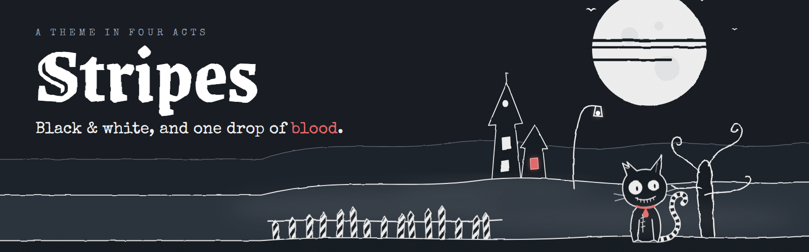
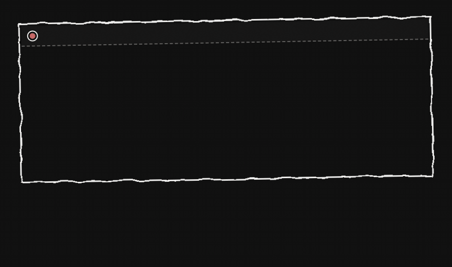
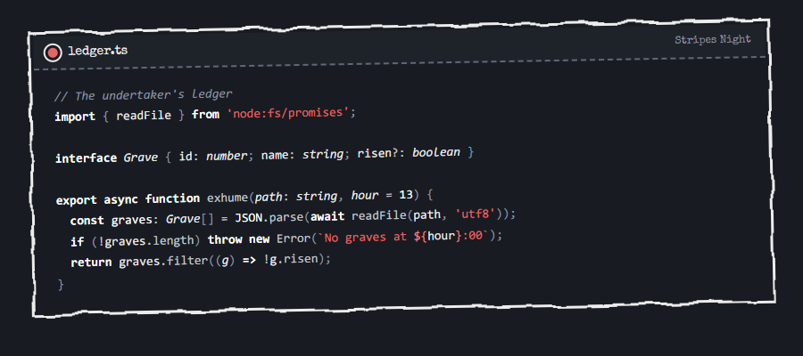
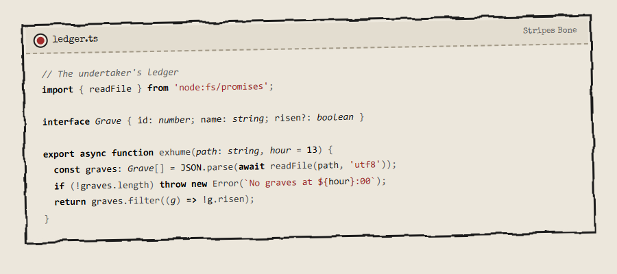
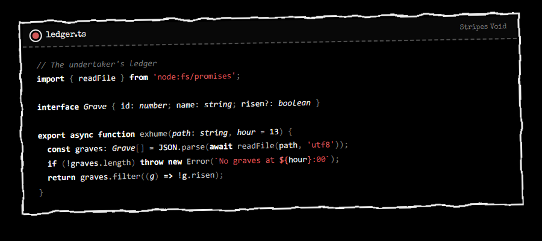
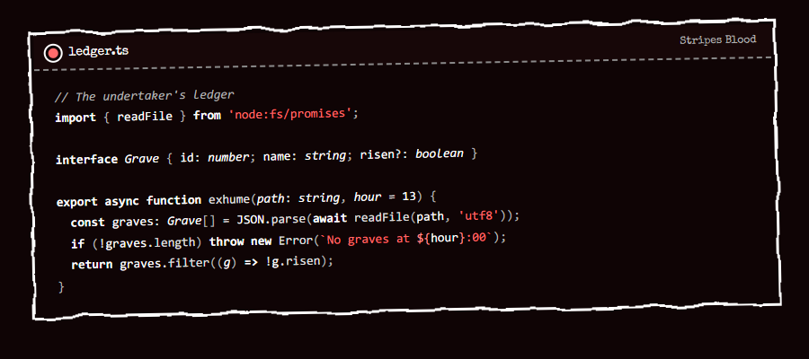
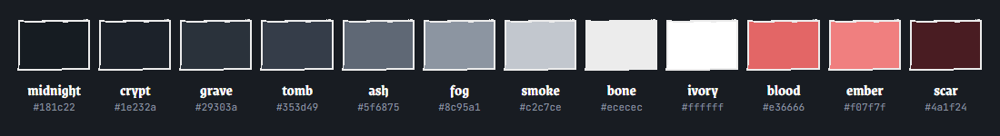
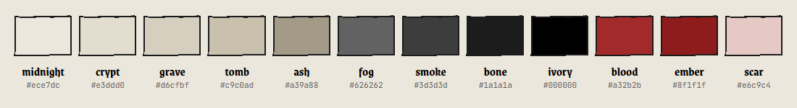
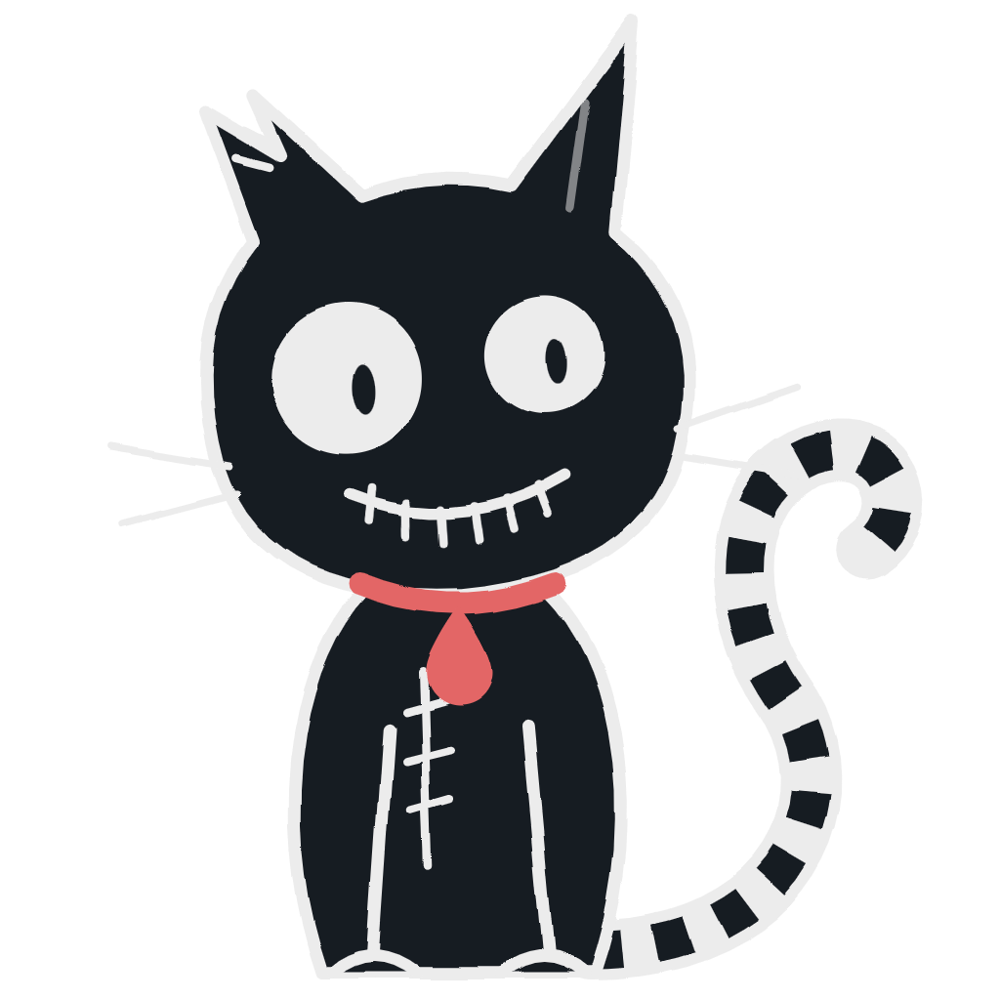

<p align="center">
  
</p>

<p align="center">
  <b>English</b> · <a href="README.es.md">Español</a>
</p>

<p align="center">
  <a href="https://github.com/laktolyx-rgb/Stripes/actions/workflows/ci.yml"></a>
  <a href="https://marketplace.visualstudio.com/items?itemName=stripes-theme.stripes"></a>
  <a href="https://open-vsx.org/extension/stripes-theme/stripes"></a>
  <a href="https://www.npmjs.com/package/@stripes-theme/palette"></a>
  
  <a href="LICENSE"></a>
</p>

<p align="center"><i>A hand-inked, stop-motion gothic theme. Ten apps, four variants, one palette.<br>Everything is black and white, except the one thing that matters.</i></p>

<p align="center">
  <a href="https://laktolyx-rgb.github.io/Stripes"><b>Website & playground</b></a> ·
  <a href="#install">Install</a> ·
  <a href="#the-palette">Palette</a> ·
  <a href="CONTRIBUTING.md">Add an app</a>
</p>

<p align="center"></p>

## The picture, in four acts

| | |
|:---:|:---:|
| **Act I: Night**<br><sub>The original. Industrial blue-charcoal, bone and blood.</sub><br> | **Act II: Bone**<br><sub>Old parchment and dried ink. The light one.</sub><br> |
| **Act III: Void**<br><sub>True `#000` for OLED. Pixels sleep in their coffins.</sub><br> | **Act IV: Blood**<br><sub>High contrast on oxblood black. Every token passes WCAG AAA.</sub><br> |

## Why Stripes

- **One accent, used with intent.** Structure comes from brightness and type: bold keywords, italic comments, white constants. Red is kept for strings, links and errors, so when you see it, it means something.
- **Readable by law.** CI checks every text color against WCAG on every commit: AA for Night, Bone and Void, and AAA for Blood. A palette change that hurts legibility doesn't merge.
- **One palette, every app.** [`palette.json`](palette/palette.json) is the single source of truth. Ports are generated, never hand-tuned, so VS Code and your terminal can't drift apart.
- **A brand, not a hex list.** Wallpapers, a mascot (hi, Mortimer), a [playground](https://laktolyx-rgb.github.io/Stripes#playground), and a [spec](palette/spec.md) that says what goes where.

## Install

| App | How |
|---|---|
| **VS Code** · Cursor · VSCodium | Marketplace / Open VSX: search **Stripes**, then `Ctrl+K Ctrl+T` → *Stripes Night*. ([details](ports/vscode)) |
| **Neovim** | lazy.nvim: `{ "laktolyx-rgb/Stripes", config = … }`, with Treesitter, LSP and 15 plugins. ([details](ports/nvim)) |
| **Zed** | Extensions → **Stripes** ([details](ports/zed)) |
| **JetBrains** IDEs | Plugins → Marketplace → **Stripes** ([details](ports/jetbrains)) |
| **Ghostty** | `theme = dark:stripes-night,light:stripes-bone` ([details](ports/ghostty)) |
| **Kitty** | `include stripes-night.conf` ([details](ports/kitty)) |
| **Alacritty** | `import = ["stripes-night.toml"]` ([details](ports/alacritty)) |
| **Windows Terminal** | Drop `stripes.json` in the Fragments folder ([details](ports/windows-terminal)) |
| **Obsidian** | Community themes → **Stripes**, with Style Settings for Void/Blood ([details](ports/obsidian)) |
| **Discord** | Vencord / BetterDiscord CSS ([details](ports/discord)) |

Every release also ships zips for terminals and apps, plus **16 wallpapers** (4 variants × 1080p, 1440p, 4K and phone) on the [Releases page](https://github.com/laktolyx-rgb/Stripes/releases).

> Your app isn't here? A new port is one file. See [**Add an app**](CONTRIBUTING.md).

## The palette




<details>
<summary><b>All hex values (4 variants)</b></summary>

| Color | Role | Night | Bone | Void | Blood |
|---|---|---|---|---|---|
| midnight | background | `#181c22` | `#ece7dc` | `#000000` | `#0f0405` |
| crypt | panels | `#1e232a` | `#e3ddd0` | `#080808` | `#170708` |
| grave | line, borders | `#29303a` | `#d6cfbf` | `#121212` | `#240c0e` |
| tomb | selection | `#353d49` | `#c9c0ad` | `#1f1f1f` | `#401215` |
| ash | guides (decoration) | `#5f6875` | `#a39a88` | `#4d4d4d` | `#8a8a8a` |
| fog | comments | `#8c95a1` | `#626262` | `#787878` | `#b3b3b3` |
| smoke | functions | `#c2c7ce` | `#3d3d3d` | `#bdbdbd` | `#e0e0e0` |
| bone | text | `#ececec` | `#1a1a1a` | `#ececec` | `#ffffff` |
| ivory | keywords (bold) | `#ffffff` | `#000000` | `#ffffff` | `#ffffff` |
| blood | the drop: strings, accent | `#e36666` | `#a32b2b` | `#d15858` | `#ff6b6b` |
| ember | errors | `#f07f7f` | `#8f1f1f` | `#e57373` | `#ff8a8a` |
| scar | accent background | `#4a1f24` | `#e6c9c4` | `#2e0f0f` | `#5c1519` |

</details>

### Use it in your own project

```sh
npm i @stripes-theme/palette
```

```js
import { variants } from '@stripes-theme/palette';
variants.night.roles.keyword; // { color: 'ivory', hex: '#ffffff', bold: true, italic: false }
```

```css
@import '@stripes-theme/palette/css';            /* CSS variables, switch with <html data-stripes="bone"> */
@import '@stripes-theme/palette/tailwind.css';   /* Tailwind v4: bg-stripes-midnight text-stripes-blood */
```

## How it's built

```
palette/palette.json ──► builder (validate WCAG) ──► templates/<app> ──► ports/<app>
                                                                     └─► site, wallpapers, GIF
```

```sh
npm install
npm run validate     # contrast table for every variant
npm run build        # palette package + all ports
npm run check        # CI: fails if ports/ drifted from the templates
npm test
npm run site:dev     # the landing page
npm run assets       # icons, previews, social image, wallpapers, GIF
```

## Credits

Made by [@laktolyx-rgb](https://github.com/laktolyx-rgb) and contributors. Mortimer appears as himself.
Inspired by the craft of hand-made stop-motion films and by the open-source theme communities that came before ([Catppuccin](https://github.com/catppuccin), [Dracula](https://github.com/dracula)).

MIT © Stripes contributors

<p align="center"></p>
